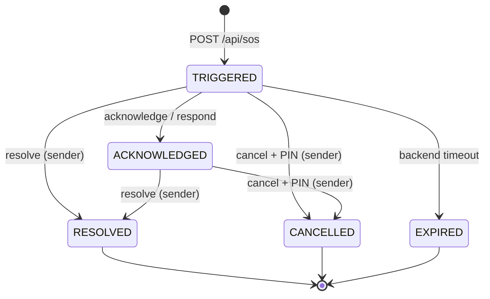

# SOS Allert Backend API

Dokumen ini adalah ringkasan kontrak API untuk tim frontend web. Kontrak lengkap
(method, request/response schema, status code) ada di [`api-spec.json`](./api-spec.json).

- Base URL lokal: `http://localhost:3000`
- WebSocket: `ws://localhost:3000`
- Format data: JSON, kecuali download media (binary) dan `/metrics` (text Prometheus).
- Semua timestamp adalah **epoch milliseconds** (`int64`).

## Autentikasi

Endpoint publik (tanpa token):

- `POST /api/users` (register)
- `POST /api/users/_login` (login)
- `GET /metrics`

`POST /api/users` dan `POST /api/users/_login` dibatasi per IP klien:
**5 percobaan/menit**, lalu **lockout 15 menit** (`429` + header
`Retry-After`). Register dan login memakai bucket yang sama. Di belakang
reverse proxy, set `web.proxy_header` (mis. `X-Forwarded-For`) agar IP klien
yang dipakai bukan IP proxy.

Endpoint lain wajib mengirim token mentah hasil login:

```http
Authorization: <token>
```

Jangan memakai prefix `Bearer `. Token disimpan di kolom `users.token` dan
dihapus saat logout. WebSocket memakai query `?token=<token>`.

## Response envelope

Sukses:

```json
{ "data": { } }
```

List dengan pagination (hanya `GET /api/contacts`):

```json
{
  "data": [],
  "paging": { "page": 1, "size": 10, "total_item": 0, "total_page": 0 }
}
```

Error ditangani global handler:

```json
{ "errors": "Not Found" }
```

## Jenis API dan kegunaannya

| Kategori | Path | Gunanya |
|---|---|---|
| **User & Auth** | `/api/users`, `/api/users/_login`, `/api/users/_current` | Registrasi, login/logout, profil user, set Safe PIN, dan registrasi device token FCM/APNs. |
| **Contact** | `/api/contacts` | CRUD kontak milik user, pencarian nama/telepon/email, dan pagination. |
| **Address** | `/api/contacts/{contactId}/addresses` | CRUD alamat yang dimiliki sebuah kontak. |
| **Location** | `/api/location` | Heartbeat lokasi user ke Redis GEO + histori MySQL, baca posisi terakhir, dan cari responder terdekat untuk peta. |
| **SOS Incident** | `/api/sos`, `/api/sos/{alertId}` | Trigger insiden, query insiden aktif/detail/inbox, cancel, acknowledge, resolve, respond (ETA), breadcrumb, dan media bukti. |
| **Emergency Contact** | `/api/emergency-contacts` | Kontak Tier-1 untuk fallback SMS/voice, terpisah dari tabel kontak biasa. |
| **Live Tracking** | `WS /ws/sos/{alertId}/track` | Stream posisi korban dan perubahan status insiden secara real-time. |
| **Observability** | `/metrics` | Metrik Prometheus untuk operasional (bukan untuk frontend user). |

## Daftar endpoint

### User & Auth

| Method | Path | Auth | Kegunaan |
|---|---|:---:|---|
| `POST` | `/api/users` | - | Register user (`id`, `name`, `password`). |
| `POST` | `/api/users/_login` | - | Login; response `data.token` adalah token sesi. |
| `DELETE` | `/api/users` | ✅ | Logout; response `data: true`. |
| `GET` | `/api/users/_current` | ✅ | Profil user saat ini. |
| `PATCH` | `/api/users/_current` | ✅ | Update `name`, `password`, `safe_pin`, `fcm_token`, `apns_token`. Semua opsional. |

Catatan:

- `safe_pin` wajib 4 digit numerik dan disimpan sebagai bcrypt hash. Tanpa Safe PIN,
  endpoint cancel mengembalikan `412 Precondition Failed`.
- Setidaknya satu dari `fcm_token` / `apns_token`, atau subscribe topic FCM
  `user_<userId>`, diperlukan agar push notification sampai ke device.

### Contact

| Method | Path | Auth | Kegunaan |
|---|---|:---:|---|
| `POST` | `/api/contacts` | ✅ | Buat kontak. `first_name` wajib. |
| `GET` | `/api/contacts` | ✅ | List kontak. Query: `page`, `size`, `name`, `phone`, `email`. |
| `GET` | `/api/contacts/{contactId}` | ✅ | Detail kontak. |
| `PUT` | `/api/contacts/{contactId}` | ✅ | Ganti kontak; `first_name` wajib. |
| `DELETE` | `/api/contacts/{contactId}` | ✅ | Hapus kontak. |

Response item berisi `id`, `first_name`, `last_name`, `email`, `phone`,
`created_at`, `updated_at`, dan opsional `addresses`.

### Address

| Method | Path | Auth | Kegunaan |
|---|---|:---:|---|
| `POST` | `/api/contacts/{contactId}/addresses` | ✅ | Buat alamat untuk kontak. |
| `GET` | `/api/contacts/{contactId}/addresses` | ✅ | List alamat kontak. |
| `GET` | `/api/contacts/{contactId}/addresses/{addressId}` | ✅ | Detail alamat. |
| `PUT` | `/api/contacts/{contactId}/addresses/{addressId}` | ✅ | Update alamat. Semua field opsional. |
| `DELETE` | `/api/contacts/{contactId}/addresses/{addressId}` | ✅ | Hapus alamat. |

Field alamat: `street`, `city`, `province`, `postal_code`, `country`.

### Location

| Method | Path | Auth | Kegunaan |
|---|---|:---:|---|
| `GET` | `/api/location` | ✅ | Baca posisi terakhir user dari Redis: `user_id`, `latitude`, `longitude`, `last_seen`, `stale`. `404` jika belum pernah heartbeat. |
| `GET` | `/api/location/nearby` | ✅ | List responder aktif di sekitar user. Query `radius_m` (default 1000, min 100, max 5000). User yang `last_seen`-nya > 2 menit dan diri sendiri difilter; koordinat dibulatkan ~100 m (`masked: true`), maksimal 50, urut terdekat. `404` jika user belum punya heartbeat. |
| `PUT` | `/api/location` | ✅ | Kirim `{ "latitude": number, "longitude": number }`. Menulis Redis GEO + `users:last_seen` dan upsert satu baris histori ke MySQL `locations`. |

Kirim heartbeat minimal tiap **2 menit** saat user aktif. User yang
`users:last_seen`-nya lebih tua dari 2 menit tidak dimasukkan sebagai penerima
SOS di sekitar lokasi.

Contoh `GET /api/location/nearby?radius_m=1000` (koordinat sudah dimask
~100 m; user sendiri dan user stale tidak muncul):

```json
{
  "data": {
    "radius_m": 1000,
    "count": 1,
    "masked": true,
    "responders": [
      {
        "user_id": "user-b",
        "latitude": -6.21,
        "longitude": 106.848,
        "distance_m": 262,
        "last_seen": 1730304000000
      }
    ]
  }
}
```

`GET /api/location/nearby` membutuhkan heartbeat user itu sendiri; kalau
belum ada, response-nya `404`. Panggil `PUT /api/location` dulu.

### SOS Incident

| Method | Path | Auth | Kegunaan |
|---|---|:---:|---|
| `POST` | `/api/sos` | ✅ | Trigger SOS. Body opsional; fallback ke lokasi Redis terakhir. Response `201`. |
| `GET` | `/api/sos/active` | ✅ | Insiden aktif milik user (cold start). |
| `GET` | `/api/sos/inbox` | ✅ | Insiden yang push-nya pernah diterima user (inbox responder). |
| `GET` | `/api/sos/{alertId}` | ✅ | Detail insiden; koordinat dimask untuk non-peserta. |
| `POST` | `/api/sos/{alertId}/cancel` | ✅ | Batalkan false alarm dengan `{ "pin": "1234", "reason": "FALSE_ALARM" }`. Sender saja. |
| `POST` | `/api/sos/{alertId}/acknowledge` | ✅ | `TRIGGERED` → `ACKNOWLEDGED`. Response detail memakai sudut pandang pemanggil; koordinat dimask kalau bukan sender/responder. |
| `POST` | `/api/sos/{alertId}/resolve` | ✅ | Tutup insiden. Sender saja. |
| `POST` | `/api/sos/{alertId}/respond` | ✅ | Responder menjawab dengan koordinatnya; response berisi `eta_seconds` dan jarak. |
| `GET` | `/api/sos/{alertId}/breadcrumbs` | ✅ | Riwayat posisi insiden (sender/responder). |
| `POST` | `/api/sos/{alertId}/breadcrumbs` | ✅ | Simpan satu titik tracking. Sender saja, insiden harus aktif. |
| `GET` | `/api/sos/{alertId}/media` | ✅ | List media insiden (sender/responder). |
| `POST` | `/api/sos/{alertId}/media` | ✅ | Upload media (`multipart/form-data`, field `file`). Sender saja, `audio/*`/`video/*`, maks 50 MB. |
| `GET` | `/api/sos/{alertId}/media/{mediaId}` | ✅ | Download/stream media (sender/responder). |

Detail trigger:

- Request body: `latitude`, `longitude`, `accuracy_meters`, `battery_percentage`,
  `emergency_type` (`DANGER|MEDICAL|ACCIDENT`), `description`.
- Header `X-Idempotency-Key` mencegah duplikasi saat retry (TTL 5 menit).
- Rate limit: maksimal **3 trigger per user per jam**; lebih dari itu `429`.
- `description` dipakai AI triage opsional (fail-open). `emergency_type` eksplisit
  menang atas hasil klasifikasi.
- Radius fan-out adaptif 1/2/5 km, maksimal 50 penerima, ditambah emergency contacts.

Response trigger:

```json
{
  "data": {
    "alert_id": "alt_...",
    "status": "TRIGGERED",
    "grace_period_seconds": 10,
    "recipients_notified": 7,
    "triggered_at": 1730304000000,
    "triage": {
      "emergency_type": "MEDICAL",
      "severity": 0.8,
      "summary": "PRIORITAS TINGGI: Kemungkinan darurat medis"
    }
  }
}
```

Status insiden:



Hanya `TRIGGERED` dan `ACKNOWLEDGED` yang dianggap aktif.

### Emergency Contact

| Method | Path | Auth | Kegunaan |
|---|---|:---:|---|
| `GET` | `/api/emergency-contacts` | ✅ | List kontak Tier-1 milik user. |
| `POST` | `/api/emergency-contacts` | ✅ | Buat kontak Tier-1 (`contact_name`, `phone_number`, `relationship`). |

Kontak ini dipakai backend untuk fallback SMS/voice, bukan untuk CRUD kontak
biasa. Belum ada endpoint update/delete.

### Observability

| Method | Path | Auth | Kegunaan |
|---|---|:---:|---|
| `GET` | `/metrics` | - | Metrik Prometheus (text/plain). |

## WebSocket live tracking

```
WS /ws/sos/{alertId}/track?token=<token>
```

- Pengirim (sender) mengirim frame JSON breadcrumb:

```json
{
  "latitude": -6.2092,
  "longitude": 106.8462,
  "speed_mps": 4.2,
  "heading_deg": 135.0,
  "battery_percentage": 17,
  "timestamp": 1730304060000
}
```

- Server menyiarkan posisi ke subscriber:

```json
{
  "type": "LOCATION_UPDATE",
  "alert_id": "alt_...",
  "latitude": -6.2092,
  "longitude": 106.8462,
  "speed_mps": 4.2,
  "heading_deg": 135.0
}
```

- Server menyiarkan perubahan status:

```json
{
  "type": "ALERT_STATUS",
  "alert_id": "alt_...",
  "status": "RESOLVED",
  "updated_at": 1730304075000
}
```

Hanya sender atau responder terdaftar yang boleh berlangganan. Error
autentikasi/otorisasi dikirim sebagai `{"error": "..."}` lalu koneksi ditutup.

## Status code

| Code | Arti |
|---|---|
| `200` | Sukses. |
| `201` | Insiden SOS berhasil di-trigger. |
| `400` | Body/query/path tidak valid. |
| `401` | Token tidak ada/tidak valid, kredensial salah, atau PIN salah. |
| `403` | User tidak berhak (bukan sender/responder, atau sender mencoba respond). |
| `404` | Resource tidak ditemukan atau bukan milik user. |
| `409` | Duplikat atau transisi status insiden tidak valid. |
| `412` | Precondition gagal: Safe PIN belum diatur atau storage media belum dikonfigurasi. |
| `429` | Rate limit terlampaui: auth 5/menit/IP + lockout 15 menit, atau SOS 3/jam/user. |
| `500` | Error internal/dependency. |

## Catatan implementasi

- Kontak dan alamat adalah data milik user yang login; semua query menyertakan
  `user_id`/`contact_id` sehingga user tidak bisa mengakses data user lain.
- `GET /api/sos/{alertId}` bisa diakses user terautentikasi mana pun, tetapi
  koordinat dibulatkan (~100 m) dan `masked: true` bila user bukan sender/responder.
- `PATCH /api/users/_current` perlu dipanggil untuk set `safe_pin` sebelum fitur
  cancel bisa dipakai.
- Migrasi SOS harus dijalankan sebelum endpoint SOS dipakai: lihat
  `db/migrations/20261027000000_create_table_alerts*`,
  `20261031000000_alerts_v2*`, `20261101000000_alerts_triage*`, dan
  `20261102000000_alert_recipients*`.
