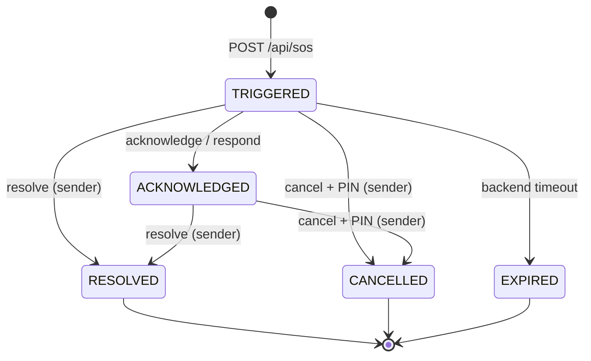

# SOS Allert Backend API

Dokumen ini adalah ringkasan kontrak API untuk tim frontend web. Kontrak lengkap
(method, request/response schema, status code) ada di [`api-spec.json`](./api-spec.json).

- Base URL lokal: `http://localhost:3000`
- WebSocket: `ws://localhost:3000`
- Format data: JSON, kecuali download media (binary) dan `/metrics` (text Prometheus).
- Semua timestamp adalah **epoch milliseconds** (`int64`).

## Autentikasi

Endpoint publik (tanpa token):

- `POST /api/users` (register)
- `POST /api/users/_login` (login)

`GET /metrics` bukan endpoint publik: hanya aktif bila `metrics.token` diisi,
dan wajib dikirim sebagai header `Authorization: <token>` (`Bearer <token>`
juga diterima). Tanpa token yang cocok → `401`; bila `metrics.token` kosong
route tidak didaftarkan → `404`.

`POST /api/users` dan `POST /api/users/_login` dibatasi per IP klien:
**5 percobaan/menit**, lalu **lockout 15 menit** (`429` + header
`Retry-After`). Register dan login memakai bucket yang sama. Di belakang
reverse proxy, set `web.proxy_header` (mis. `X-Forwarded-For`) agar IP klien
yang dipakai bukan IP proxy.

Endpoint lain wajib mengirim token mentah hasil login:

```http
Authorization: <token>
```

Jangan memakai prefix `Bearer `. Token sesi hanya disimpan di Redis
(`auth:token:<token>`) dengan masa berlaku `auth.token_ttl_hours` (default
168 jam). Login baru membatalkan token sebelumnya (single-session) dan logout
langsung menghapus sesi. Setelah TTL habis atau setelah login di device lain,
request berikutnya akan `401`. WebSocket **tidak** memakai query `?token=`:
browser mengirim frame pertama `{"type":"auth","token":"<token>"}` lalu
menunggu `{"type":"auth_ok"}`; klien native boleh memakai header
`Authorization` saat handshake.

## Response envelope

Sukses:

```json
{ "data": { } }
```

List dengan pagination (`GET /api/contacts` dan `GET /api/sos/history`):

```json
{
  "data": [],
  "paging": { "page": 1, "size": 10, "total_item": 0, "total_page": 0 }
}
```

Error ditangani global handler:

```json
{ "errors": "Not Found" }
```

## Jenis API dan kegunaannya

| Kategori | Path | Gunanya |
|---|---|---|
| **User & Auth** | `/api/users`, `/api/users/_login`, `/api/users/_current` | Registrasi, login/logout, profil user, set Safe PIN, dan registrasi device token FCM/APNs. |
| **Contact** | `/api/contacts` | CRUD kontak milik user, pencarian nama/telepon/email, dan pagination. |
| **Address** | `/api/contacts/{contactId}/addresses` | CRUD alamat yang dimiliki sebuah kontak. |
| **Location** | `/api/location` | Heartbeat lokasi user ke Redis GEO + histori MySQL, baca posisi terakhir, dan cari responder terdekat untuk peta. |
| **SOS Incident** | `/api/sos`, `/api/sos/{alertId}` | Trigger insiden, query insiden aktif/detail/inbox, **riwayat paged** (`/api/sos/history`) dan **ringkasan kartu** (`/api/sos/summary`), cancel, acknowledge, resolve, respond (ETA), breadcrumb, dan media bukti. |
| **Emergency Contact** | `/api/emergency-contacts` | Kontak Tier-1 untuk fallback SMS/voice, terpisah dari tabel kontak biasa. |
| **Push (Web Push browser)** | `/api/push` | Langganan Web Push browser (VAPID) — kanal push tanpa kredensial Firebase. |
| **Live Tracking** | `WS /ws/sos/{alertId}/track` | Stream posisi korban dan perubahan status insiden secara real-time. Auth lewat frame pertama `{"type":"auth"}` → `{"type":"auth_ok"}` (tanpa token di URL). |
| **Observability** | `/metrics` | Metrik Prometheus untuk operasional (bukan untuk frontend user). |

## Daftar endpoint

### User & Auth

| Method | Path | Auth | Kegunaan |
|---|---|:---:|---|
| `POST` | `/api/users` | - | Register user (`id`, `name`, `password`). |
| `POST` | `/api/users/_login` | - | Login; response `data.token` adalah token sesi. |
| `DELETE` | `/api/users` | ✅ | Logout; response `data: true`. |
| `GET` | `/api/users/_current` | ✅ | Profil user saat ini. |
| `PATCH` | `/api/users/_current` | ✅ | Update `name`, `password`, `safe_pin`, `fcm_token`, `apns_token`. Semua opsional. |

Catatan:

- `safe_pin` wajib 4 digit numerik dan disimpan sebagai bcrypt hash. Tanpa Safe PIN,
  endpoint cancel mengembalikan `412 Precondition Failed`.
- Setidaknya satu dari `fcm_token` / `apns_token`, atau subscribe topic FCM
  `user_<userId>`, diperlukan agar push notification sampai ke device.

### Contact

| Method | Path | Auth | Kegunaan |
|---|---|:---:|---|
| `POST` | `/api/contacts` | ✅ | Buat kontak. `first_name` wajib. |
| `GET` | `/api/contacts` | ✅ | List kontak. Query: `page`, `size`, `name`, `phone`, `email`. |
| `GET` | `/api/contacts/{contactId}` | ✅ | Detail kontak. |
| `PUT` | `/api/contacts/{contactId}` | ✅ | Ganti kontak; `first_name` wajib. |
| `DELETE` | `/api/contacts/{contactId}` | ✅ | Hapus kontak. |

Response item berisi `id`, `first_name`, `last_name`, `email`, `phone`,
`created_at`, `updated_at`, dan opsional `addresses`.

### Address

| Method | Path | Auth | Kegunaan |
|---|---|:---:|---|
| `POST` | `/api/contacts/{contactId}/addresses` | ✅ | Buat alamat untuk kontak. |
| `GET` | `/api/contacts/{contactId}/addresses` | ✅ | List alamat kontak. |
| `GET` | `/api/contacts/{contactId}/addresses/{addressId}` | ✅ | Detail alamat. |
| `PUT` | `/api/contacts/{contactId}/addresses/{addressId}` | ✅ | Update alamat. Semua field opsional. |
| `DELETE` | `/api/contacts/{contactId}/addresses/{addressId}` | ✅ | Hapus alamat. |

Field alamat: `street`, `city`, `province`, `postal_code`, `country`.

### Location

| Method | Path | Auth | Kegunaan |
|---|---|:---:|---|
| `GET` | `/api/location` | ✅ | Baca posisi terakhir user dari Redis: `user_id`, `latitude`, `longitude`, `last_seen`, `stale`. `404` jika belum pernah heartbeat. |
| `GET` | `/api/location/nearby` | ✅ | List responder aktif di sekitar user. Query `radius_m` (default 1000, min 100, max 5000). User yang `last_seen`-nya > 2 menit dan diri sendiri difilter; koordinat dibulatkan ~100 m (`masked: true`), `distance_m` dibulatkan ke kelipatan 100 m terdekat, maksimal 50, urut terdekat. `404` jika user belum punya heartbeat. |
| `PUT` | `/api/location` | ✅ | Kirim `{ "latitude": number, "longitude": number }`. Menulis Redis GEO + `users:last_seen` dan upsert satu baris histori ke MySQL `locations`. |

Kirim heartbeat minimal tiap **2 menit** saat user aktif. User yang
`users:last_seen`-nya lebih tua dari 2 menit tidak dimasukkan sebagai penerima
SOS di sekitar lokasi.

Contoh `GET /api/location/nearby?radius_m=1000` (koordinat sudah dimask
~100 m, `distance_m` sudah dibulatkan ke kelipatan 100 m; user sendiri dan user
stale tidak muncul):

```json
{
  "data": {
    "radius_m": 1000,
    "count": 1,
    "masked": true,
    "responders": [
      {
        "user_id": "user-b",
        "latitude": -6.21,
        "longitude": 106.848,
        "distance_m": 300,
        "last_seen": 1730304000000
      }
    ]
  }
}
```

`GET /api/location/nearby` membutuhkan heartbeat user itu sendiri; kalau
belum ada, response-nya `404`. Panggil `PUT /api/location` dulu.

`distance_m` sengaja hanya seakurat ~100 m: jarak presisi dari dua titik vantage
pilihan pemanggil cukup untuk menginterseksi dua lingkaran dan merekonstruksi
posisi user di dalam sel yang sudah diblur. Filter radius tetap memakai jarak
asli, jadi siapa yang muncul tidak terpengaruh pembulatan ini.

### SOS Incident

| Method | Path | Auth | Kegunaan |
|---|---|:---:|---|
| `POST` | `/api/sos` | ✅ | Trigger SOS. Body opsional; fallback ke lokasi Redis terakhir. Response `201`. |
| `POST` | `/api/sos/classify` | ✅ | Klasifikasi klip audio pra-trigger (`multipart/form-data`, field `file`, audio ≤ 25 MB). Tidak menyimpan apa pun ke DB. Hasil server (`emergency_type`, `severity`, `summary`) disimpan 2 menit sekali-pakai dan **otomatis** dipakai `POST /api/sos` berikutnya dari user yang sama; trigger tidak perlu mengirim ulang nilainya. Rate limit `sos.classify_rate_limit_per_hour` (default **10/jam**) → `429` + `Retry-After`; store limiter error → `503` (fail-closed). |
| `GET` | `/api/sos/active` | ✅ | Insiden aktif milik user (cold start). |
| `GET` | `/api/sos/inbox` | ✅ | Insiden yang push-nya pernah diterima user (inbox responder). |
| `GET` | `/api/sos/history` | ✅ | Riwayat paged (`role=sent\|received`, `status`, `page`, `size`, `from_ms`, `to_ms`), semua status termasuk `RESOLVED`/`CANCELLED`/`EXPIRED`. Item `AlertDetailResponse` tanpa `responders[]`/`breadcrumbs`. |
| `GET` | `/api/sos/summary` | ✅ | Agregat kartu: `sent`/`received` per status + `responded.total`/`responded.resolved`. |
| `GET` | `/api/sos/{alertId}` | ✅ | Detail insiden; `404` untuk non-peserta (bukan sender, penerima notifikasi, atau responder terdaftar). Koordinat dimask untuk peserta yang belum respond. `responders[]` (nama + `distance_m`/`eta_seconds` + `responded_at`) hanya diisi untuk sender/responder terdaftar; peserta lain hanya dapat `responders_en_route`. |
| `POST` | `/api/sos/{alertId}/cancel` | ✅ | Batalkan false alarm dengan `{ "pin": "1234", "reason": "FALSE_ALARM" }`. Sender saja. |
| `POST` | `/api/sos/{alertId}/acknowledge` | ✅ | `TRIGGERED` → `ACKNOWLEDGED`. Hanya peserta; non-peserta `403`. Response detail memakai sudut pandang pemanggil; koordinat dimask kalau bukan sender/responder. |
| `POST` | `/api/sos/{alertId}/resolve` | ✅ | Tutup insiden. Sender saja. |
| `POST` | `/api/sos/{alertId}/respond` | ✅ | Responder menjawab dengan koordinatnya; response berisi `eta_seconds` dan jarak. Hanya peserta; non-peserta dan sender `403`. |
| `GET` | `/api/sos/{alertId}/breadcrumbs` | ✅ | Riwayat posisi insiden (sender/responder). |
| `POST` | `/api/sos/{alertId}/breadcrumbs` | ✅ | Simpan satu titik tracking. Sender saja, insiden harus aktif. |
| `GET` | `/api/sos/{alertId}/media` | ✅ | List media insiden (sender/responder). |
| `POST` | `/api/sos/{alertId}/media` | ✅ | Upload media (`multipart/form-data`, field `file`). Sender saja, `audio/*`/`video/*`, maks 50 MB. Audio ≤ 25 MB ditranskrip (Groq/Whisper-compatible), lalu transcript masuk triage dan response memuat `transcript`, `transcription_status`, `triage`. Kalau severity naik, fan-out diperluas ke responder baru (`escalated: true`, `recipients_added: N`). |
| `GET` | `/api/sos/{alertId}/media/{mediaId}` | ✅ | Download media (sender/responder). Selalu `Content-Disposition: attachment`; `Content-Type` hanya dari allowlist (`audio/webm|mp4|mpeg|ogg|wav`, `video/webm|mp4`, `image/jpeg|png`), selain itu `application/octet-stream`. |

Detail trigger:

- Request body: `latitude`, `longitude`, `accuracy_meters`, `battery_percentage`,
  `emergency_type` (`DANGER|MEDICAL|ACCIDENT`), `description`, dan opsional
  `client_severity` (0–1) + `client_summary` (maks 500) — **klaim pelapor**,
  bukan triage.
- Header `X-Idempotency-Key` mencegah duplikasi saat retry (TTL 5 menit).
- Rate limit: `sos.rate_limit_per_hour` trigger per user per jam (default **3**); lebih dari itu `429` dengan pesan yang menyebut limit aktif. Bisa dimatikan di backend dengan `sos.rate_limit_disabled: true` (default `false`).
- **Triage dan radius selalu dihitung server**, dari dua sumber: (a) hasil
  `POST /api/sos/classify` milik user yang sama — dipakai otomatis dalam 2
  menit, sekali pakai — atau (b) `description` (AI triage opsional, fail-open).
  `emergency_type` eksplisit menang atas klasifikasi. `severity` server
  di-clamp ke `0..1`.
- `client_severity`/`client_summary` **tidak** memengaruhi triage atau radius:
  hanya di-echo di response dan dikirim ke notifikasi berlabel
  `Pelapor menyebut: ...`. Nama lama `severity`/`summary` diabaikan (bukan
  error), jadi aplikasi versi lama tetap jalan.
- Radius fan-out adaptif 1/2/5 km, maksimal 50 penerima, ditambah emergency contacts.
- Klip audio yang baru ditranskrip setelah trigger dan menaikkan severity
  memperlebar fan-out ke radius baru: hanya responder baru yang dinotifikasi,
  tetap menunggu grace period, dan response media menandainya `escalated`.

Response trigger:

```json
{
  "data": {
    "alert_id": "alt_...",
    "status": "TRIGGERED",
    "grace_period_seconds": 10,
    "recipients_notified": 7,
    "triggered_at": 1730304000000,
    "triage": {
      "emergency_type": "MEDICAL",
      "severity": 0.8,
      "summary": "PRIORITAS TINGGI: Kemungkinan darurat medis"
    },
    "client_severity": 0.9,
    "client_summary": "sesak napas"
  }
}
```

`triage` = penilaian server. `client_severity`/`client_summary` = klaim
pelapor, hanya muncul kalau dikirim, dan tidak disimpan ke DB.

Status insiden:



Hanya `TRIGGERED` dan `ACKNOWLEDGED` yang dianggap aktif.

> Catatan `EXPIRED`: statusnya didukung penuh di filter `history` dan di
> `summary`, tetapi transisi `TRIGGERED → EXPIRED` dijalankan oleh job
> housekeeping yang saat ini belum dijadwalkan di deployment mana pun. Jadi di
> data nyata `expired` bisa selalu `0` sampai job itu dipasang.

`GET /api/sos/active` dan `GET /api/sos/inbox` **tetap aktif-only** (maks 20,
`RESOLVED`/`CANCELLED` tidak muncul). Untuk riwayat dan angka kartu, pakai
`GET /api/sos/history` dan `GET /api/sos/summary`, jangan menurunkan angka dari
kedua endpoint lama itu.

#### Riwayat alert (`GET /api/sos/history`)

```http
GET /api/sos/history?role=sent&status=closed&page=1&size=20
```

| Param | Default | Nilai |
|---|---|---|
| `role` | `sent` | `sent` (insiden yang saya trigger) \| `received` (saya pernah dinotifikasi lewat `alert_recipients`) |
| `status` | *(kosong = semua)* | `TRIGGERED` \| `ACKNOWLEDGED` \| `RESOLVED` \| `CANCELLED` \| `EXPIRED` \| `active` (TRIGGERED+ACKNOWLEDGED) \| `closed` (RESOLVED+CANCELLED+EXPIRED) |
| `page` | `1` | `>= 1` |
| `size` | `20` | `1..100` |
| `from_ms` / `to_ms` | — | epoch ms, filter `triggered_at`; `to_ms >= from_ms` |

Nilai `page`/`size` non-numerik jatuh ke default; `from_ms`/`to_ms`
non-numerik atau di luar rentang → `400`.

```json
{
  "data": [
    {
      "alert_id": "alt_...",
      "sender": { "id": "user-a", "name": "Budi" },
      "status": "RESOLVED",
      "emergency_type": "MEDICAL",
      "severity": 0.8,
      "summary": "PRIORITAS TINGGI: Kemungkinan darurat medis",
      "initial_location": { "latitude": -6.209, "longitude": 106.846 },
      "latest_location": { "latitude": -6.209, "longitude": 106.846, "updated_at": 1730304050000 },
      "responders_en_route": 3,
      "triggered_at": 1730304000000,
      "resolved_at": 1730304075000
    }
  ],
  "paging": { "page": 1, "size": 20, "total_item": 42, "total_page": 3 }
}
```

Aturan:

- Urutan `triggered_at DESC, id DESC` (tie-break supaya paging stabil).
- Item memakai bentuk detail yang sama, tetapi **tanpa** `responders[]` dan
  `breadcrumbs`; `responders_en_route` tetap terisi.
- Field opsional absen bila kosong (`omitempty`), bukan `null`: `severity`,
  `summary`, `masked`, `resolved_at`, `cancelled_at`, `latest_location.updated_at`.
- Masking sama dengan `GET /api/sos/{alertId}`: `masked: true` + koordinat ~3
  desimal bila pemanggil bukan sender dan bukan responder terdaftar.
- `role=received` tidak pernah memuat insiden yang dikirim sendiri.
- `EXPIRED` tidak punya timestamp sendiri (pakai `triggered_at`).

#### Ringkasan (`GET /api/sos/summary`)

```http
GET /api/sos/summary
```

```json
{
  "data": {
    "sent":      { "total": 12, "active": 1, "resolved": 8, "cancelled": 2, "expired": 1 },
    "received":  { "total": 6,  "active": 2, "resolved": 3, "cancelled": 1, "expired": 0 },
    "responded": { "total": 4,  "resolved": 3 }
  }
}
```

- `sent.*` = `alerts.sender_id = me`; `received.*` = join `alert_recipients`.
- `active` = `TRIGGERED + ACKNOWLEDGED`; `total` = jumlah semua bucket.
- `responded.total` = jumlah insiden berbeda yang saya jawab
  (`COUNT(DISTINCT alert_id)`); `responded.resolved` = subset yang berakhir
  `RESOLVED`.
- Semua nilai integer ≥ 0; kartu di UI tidak perlu menurunkan angka dari list.
- Pemetaan kartu yang dipakai UI (`AlertsView`): kartu 1 `sent.total`, kartu 2
  `responded.resolved`, kartu 3 `received.active`. Kalau request gagal,
  tampilkan `—`, bukan `0`.

### Emergency Contact

| Method | Path | Auth | Kegunaan |
|---|---|:---:|---|
| `GET` | `/api/emergency-contacts` | ✅ | List kontak Tier-1 milik user. |
| `POST` | `/api/emergency-contacts` | ✅ | Buat kontak Tier-1 (`contact_name`, `phone_number`, `relationship`). |

Kontak ini dipakai backend untuk fallback SMS/voice, bukan untuk CRUD kontak
biasa. Belum ada endpoint update/delete.

### Push (Web Push browser)

| Method | Path | Auth | Kegunaan |
|---|---|:---:|---|
| `GET` | `/api/push/vapid-public-key` | ✅ | VAPID public key untuk `PushManager.subscribe()`; `503` kalau kanal belum dikonfigurasi. |
| `GET` | `/api/push/subscriptions` | ✅ | List langganan push milik user. |
| `POST` | `/api/push/subscriptions` | ✅ | Simpan langganan browser (`endpoint`, `p256dh`, `auth`, `user_agent`); `endpoint` unik → upsert. `endpoint` wajib menunjuk host push service yang diizinkan (`webpush.allowed_hosts`, default `fcm.googleapis.com`, `updates.push.services.mozilla.com`, `web.push.apple.com`) — selain itu `400`. |
| `DELETE` | `/api/push/subscriptions` | ✅ | Hapus langganan (`{"endpoint": "..."}`); endpoint tak dikenal tetap `200`. |

```json
// POST /api/push/subscriptions
{
  "endpoint": "https://fcm.googleapis.com/fcm/send/...",
  "p256dh": "B...",
  "auth": "...",
  "user_agent": "Mozilla/5.0 ..."
}
```

Backend mengenkripsi payload notifikasi (RFC 8291) dan mengirim satu request per
langganan saat SOS fan-out; `404`/`410` dari push service menghapus baris
langganan otomatis. Butuh `webpush.*` di `config.json` (lihat
`../README.md` §9) dan secure context browser (`https://` atau `localhost`).

### Observability

| Method | Path | Auth | Kegunaan |
|---|---|:---:|---|
| `GET` | `/metrics` | token | Metrik Prometheus (text/plain). Hanya aktif bila `metrics.token` diset; kirim `Authorization: <token>`. |

## WebSocket live tracking

```
WS /ws/sos/{alertId}/track
```

- Browser membuka socket tanpa token di URL, lalu mengirim frame pertama
  (deadline 10 detik) dan menunggu `auth_ok` sebelum mengirim breadcrumb:

```json
{ "type": "auth", "token": "<token>" }
```

```json
{ "type": "auth_ok" }
```

- Klien native boleh mengirim header `Authorization: <token>` saat handshake
  dan langsung mengirim breadcrumb; server tetap membalas `auth_ok`.
  Query `?token=` diabaikan.

**Wajib di klien web (`../frontend/src/lib/tracking.js`)**

1. URL tidak memuat token: cukup `VITE_WS_URL`/turunan `API_BASE_URL` +
   `/ws/sos/{alertId}/track`.
2. Di `onopen`, kirim `{"type":"auth","token":"<token>"}`. Jangan menandai
   koneksi `open` dan jangan mem-flush antrean breadcrumb di langkah ini.
3. Tunggu `{"type":"auth_ok"}` — baru set status `open` dan kirim/flush
   breadcrumb yang sempat diantrekan selama `CONNECTING`/menunggu auth.
4. Jika `error` diterima (`{"error":"unauthorized"}` atau error otorisasi),
   tampilkan pesan dan hentikan reconnect; token yang sama tidak akan diterima.
5. Reconnect otomatis harus mengirim ulang auth frame dengan token terbaru
   (`getToken()`); reset state "authenticated" di setiap koneksi baru.
6. Tanpa token, jangan membuka socket sama sekali.
7. Deadline frame pertama **10 detik**; socket lama yang masih memakai
   `?token=` akan ditutup server. Deploy frontend bersamaan dengan backend.

- Pengirim (sender) mengirim frame JSON breadcrumb:

```json
{
  "latitude": -6.2092,
  "longitude": 106.8462,
  "speed_mps": 4.2,
  "heading_deg": 135.0,
  "battery_percentage": 17,
  "timestamp": 1730304060000
}
```

- Server menyiarkan posisi ke subscriber:

```json
{
  "type": "LOCATION_UPDATE",
  "alert_id": "alt_...",
  "latitude": -6.2092,
  "longitude": 106.8462,
  "speed_mps": 4.2,
  "heading_deg": 135.0
}
```

- Server menyiarkan perubahan status:

```json
{
  "type": "ALERT_STATUS",
  "alert_id": "alt_...",
  "status": "RESOLVED",
  "updated_at": 1730304075000
}
```

- Server menyiarkan hasil triage dari audio yang baru ditranskrip:

```json
{
  "type": "ALERT_TRIAGE",
  "alert_id": "alt_...",
  "emergency_type": "MEDICAL",
  "severity": 0.8,
  "summary": "PRIORITAS TINGGI: Kemungkinan darurat medis",
  "updated_at": 1730304075000
}
```

- Server menyiarkan responder yang baru menjawab:

```json
{
  "type": "RESPONDER_ADDED",
  "alert_id": "alt_...",
  "responder_id": "user-b",
  "name": "Budi",
  "distance_m": 240,
  "eta_seconds": 180,
  "responded_at": 1730304060000
}
```

Hanya sender atau responder terdaftar yang boleh berlangganan. Error
autentikasi/otorisasi dikirim sebagai frame berikut lalu koneksi ditutup:

```json
{ "error": "unauthorized" }
```

Frame `error` bersifat terminal: klien harus menampilkan pesan, menghentikan
reconnect, dan (untuk `unauthorized`) mengarahkan user login ulang. Hanya
`auth_ok` yang menandakan socket siap mengirim breadcrumb.

## Status code

| Code | Arti |
|---|---|
| `200` | Sukses. |
| `201` | Insiden SOS berhasil di-trigger. |
| `400` | Body/query/path tidak valid. |
| `401` | Token tidak ada/tidak valid, kredensial salah, atau PIN salah. |
| `403` | User tidak berhak (bukan sender/responder, atau sender mencoba respond). |
| `404` | Resource tidak ditemukan atau bukan milik user. |
| `409` | Duplikat atau transisi status insiden tidak valid. |
| `412` | Precondition gagal: Safe PIN belum diatur atau storage media belum dikonfigurasi. |
| `429` | Rate limit terlampaui: auth 5/menit/IP + lockout 15 menit, atau SOS 3/jam/user. |
| `500` | Error internal/dependency. |

## Catatan implementasi

- Kontak dan alamat adalah data milik user yang login; semua query menyertakan
  `user_id`/`contact_id` sehingga user tidak bisa mengakses data user lain.
- `GET /api/sos/{alertId}` hanya untuk peserta (sender, penerima notifikasi, atau
  responder terdaftar); user terautentikasi lain mendapat `404` supaya
  keberadaan alert id tidak bisa ditebak. Koordinat tetap dibulatkan (~100 m)
  dan `masked: true` untuk peserta yang belum respond; `responders[]` hanya
  diisi untuk sender/responder. `POST .../acknowledge` dan `POST .../respond`
  menolak non-peserta dengan `403`.
- `GET /api/sos/history` memakai aturan masking yang sama untuk setiap item.
  `GET /api/sos/active` memakai sudut pandang sender; `GET /api/sos/inbox`
  memakai sudut pandang pemanggil, jadi penerima yang belum pernah respond
  tetap mendapat `masked: true`.
- `PATCH /api/users/_current` perlu dipanggil untuk set `safe_pin` sebelum fitur
  cancel bisa dipakai.
- Migrasi SOS harus dijalankan sebelum endpoint SOS dipakai: lihat
  `db/migrations/20261027000000_create_table_alerts*`,
  `20261031000000_alerts_v2*`, `20261101000000_alerts_triage*`,
  `20261102000000_alert_recipients*`, dan
  `20261110000000_alert_history_indexes*` (index riwayat + hitung "helped").
