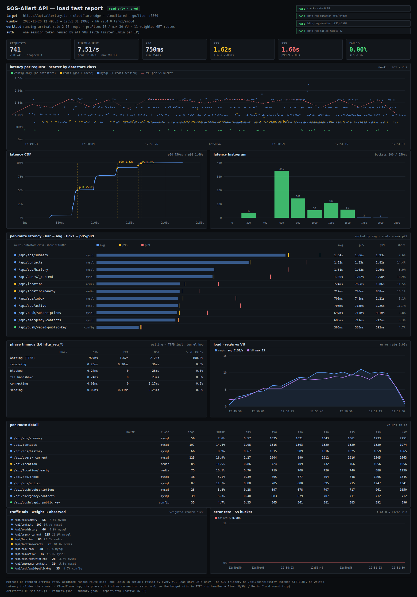

# k6 load test — read-only API mix

Production run against `https://api.allert.my.id` on **2026-11-20 12:49:53 – 12:51:31 (+08:00)**.
Traffic is read-only: no SOS trigger, no `/api/sos/classify` (spends STT + LLM tokens), no writes.

This file documents the **baseline** (`0b04ac1`). The re-run after the perf PRs (`94d5cf8`) lives in
[`rerun-2026-11-22/`](rerun-2026-11-22/README.md): avg **927 → 614 ms**, p95 **1617 → 843 ms**,
p99 **1658 → 1140 ms**, still 0% failures.



## Workload

| | |
|---|---|
| executor | `ramping-arrival-rate`, 2 → 10 req/s (warm-up 20s / ramp 30s / steady 40s / cool-down 10s) |
| VUs | pre-allocated 10, max 30 |
| routes | 11 weighted GET routes (frequencies mirror what an active client polls) |
| auth | one session token in `setup()`, reused by every VU — the login limiter is 5/min per IP |
| path | runner → Cloudflare edge → cloudflared tunnel → Go/Fiber `:3000` → Aiven MySQL / Redis Cloud |

## Result — n=741

| metric | value |
|---|---|
| p50 | 750 ms |
| p75 | 1017 ms |
| p90 | 1318 ms |
| p95 | 1617 ms |
| p99 | 1658 ms |
| p99.9 | 2046 ms |
| max | 2251 ms |
| throughput | 7.51 req/s average, 11.0 req/s peak |
| failed requests | 0.00% (741/741 HTTP 200) |
| dropped iterations | 3 (arrival rate momentarily above what the VU pool served) |

Percentiles are computed over every request sample in `results.json.gz`.

## Phase split (k6 `http_req_*`, avg / p95 / max in ms)

| phase | avg | p95 | max |
|---|---:|---:|---:|
| waiting (TTFB) | 927.14 | 1617.10 | 2250.58 |
| receiving | 0.26 | 0.20 | 36.21 |
| blocked | 0.27 | 0.00 | 25.64 |
| tls handshake | 0.24 | 0.00 | 22.52 |
| connecting | 0.03 | 0.00 | 2.17 |
| sending | 0.09 | 0.11 | 0.25 |

Connection setup is effectively zero (keep-alive holds the tunnel), so ~99.96% of the request budget sits in
`waiting` — time to first byte, i.e. handler + upstream datastore round-trip, not client-side handshakes.

## Latency by datastore class

Class is derived from the Go handlers: `config` = no I/O, `redis` = Redis GEO/cache, `mysql` = SQL (+ the
Redis session lookup that every authenticated request already pays).

| class | requests | avg (ms) | p90 (ms) | p95 (ms) |
|---|---:|---:|---:|---:|
| `config` | 35 | 365 | 382 | 384 |
| `redis` | 160 | 721 | 730 | 764 |
| `mysql` | 546 | 1024 | 1612 | 1625 |

Each datastore hop costs roughly **+356 ms (Redis)** and **+659 ms (MySQL)** on top of the ~365 ms baseline
that even a no-I/O route pays. That ordering — not the total — is the finding: the budget is dominated by
round-trips to the managed datastores, which is expected when the app, MySQL and Redis live in different
regions.

## Per route (ms)

| route | class | reqs | share | avg | p50 | p90 | p95 | p99 | max |
|---|---|---:|---:|---:|---:|---:|---:|---:|---:|
| `/api/sos/summary` | mysql | 56 | 7.6% | 1635 | 1621 | 1643 | 1661 | 1933 | 2251 |
| `/api/contacts` | mysql | 107 | 14.4% | 1316 | 1303 | 1320 | 1329 | 1820 | 1974 |
| `/api/sos/history` | mysql | 66 | 8.9% | 1015 | 989 | 1016 | 1025 | 1659 | 1665 |
| `/api/users/_current` | mysql | 125 | 16.9% | 1004 | 990 | 1012 | 1016 | 1505 | 1663 |
| `/api/location` | redis | 85 | 11.5% | 724 | 709 | 732 | 766 | 1056 | 1056 |
| `/api/location/nearby` | redis | 75 | 10.1% | 719 | 708 | 726 | 740 | 888 | 1239 |
| `/api/sos/inbox` | mysql | 38 | 5.1% | 705 | 677 | 704 | 748 | 1206 | 1345 |
| `/api/sos/active` | mysql | 87 | 11.7% | 705 | 680 | 695 | 715 | 1247 | 1341 |
| `/api/push/subscriptions` | mysql | 28 | 3.8% | 697 | 678 | 707 | 717 | 961 | 1050 |
| `/api/emergency-contacts` | mysql | 39 | 5.3% | 683 | 679 | 707 | 711 | 712 | 712 |
| `/api/push/vapid-public-key` | config | 35 | 4.7% | 365 | 361 | 381 | 383 | 392 | 396 |

## Verdict

- Thresholds passed: `http_req_failed < 2%`, `p95 < 2500 ms`, `p99 < 4000 ms`, `checks > 98%`.
- No 5xx and no auth failures at 10 req/s, so the read path is stable at the tested load.
- The run is a latency profile at modest load, not a capacity test: 100+ VU runs are deliberate and separate.

## Artifacts

| file | what |
|---|---|
| `k6-sos-api.js` | the test: weighted route mix, thresholds, one-login `setup()`, `handleSummary` |
| `run.sh` | one-shot runner: token → k6 → dashboard HTML → PNG |
| `build-dashboard.py` | `results.json` → `dashboard.html` (inline SVG, no deps) |
| `summary.json` | k6 summary: per-metric and per-route percentiles, threshold verdicts |
| `results.json.gz` | full per-request metric stream (3.4 MB raw, gzipped to ~130 KB) |
| `dashboard.png` / `dashboard.html` | the report above / its interactive source |

## Reproduce

```bash
SOS_USER=<account> SOS_PW=<password> ./run.sh      # full run
SOS_TOKEN=<session-token> ./run.sh                 # reuse a session
SMOKE=1 SOS_TOKEN=<session-token> ./run.sh         # 10s sanity pass
```

Numbers include the runner's network RTT to the Cloudflare edge; a run from another region will move the
absolute values, but the per-class ordering should hold.
