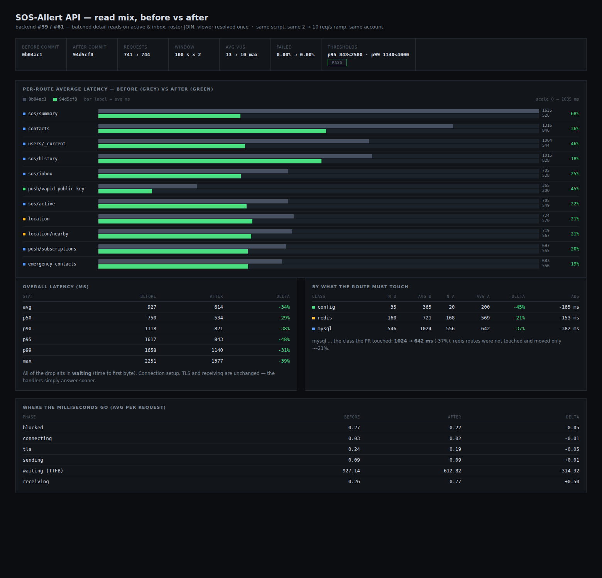

# Re-run after the perf PRs — 2026-11-22

Same script, same ramp, same account as the [baseline](../README.md): a before/after experiment on the read mix
after round-trip work landed on the authenticated read path.

| | before | after |
|---|---|---|
| commit | `0b04ac1` — perf: cut datastore round trips on the authenticated read path (#56, #57, #58) | `94d5cf8` — perf(sos): batch detail reads on active and inbox lists (#59, #61) |
| run window | 2026-11-20 12:49:53 – 12:51:31 (+08:00) | 2026-11-22 16:52:50 – 16:54:31 (+08:00) |
| requests | 741 | 744 |
| failed | 0.00% | 0.00% |



## Overall (ms)

| stat | before | after | delta |
|---|---:|---:|---:|
| avg | 927 | 614 | −34% |
| p50 | 750 | 534 | −29% |
| p90 | 1318 | 821 | −38% |
| p95 | 1617 | 843 | −48% |
| p99 | 1658 | 1140 | −31% |
| max | 2251 | 1377 | −39% |

Throughput 7.44 req/s average, max VUs 10, dropped iterations 0 (3 in the baseline).

## Per route (ms)

Sorted by absolute improvement; class is the same mapping the baseline uses.

| route | class | reqs (b → a) | avg before | avg after | Δ avg | p95 before | p95 after | p99 before | p99 after |
|---|---|---:|---:|---:|---:|---:|---:|---:|---:|
| `/api/sos/summary` | mysql | 56 → 67 | 1635 | 526 | −68% | 1661 | 679 | 1933 | 692 |
| `/api/contacts` | mysql | 107 → 109 | 1316 | 846 | −36% | 1329 | 995 | 1820 | 1033 |
| `/api/users/_current` | mysql | 125 → 97 | 1004 | 544 | −46% | 1016 | 687 | 1505 | 729 |
| `/api/sos/history` | mysql | 66 → 78 | 1015 | 828 | −18% | 1025 | 847 | 1659 | 1049 |
| `/api/sos/inbox` | mysql | 38 → 46 | 705 | 528 | −25% | 748 | 676 | 1206 | 783 |
| `/api/push/vapid-public-key` | config | 35 → 20 | 365 | 200 | −45% | 383 | 226 | 392 | 337 |
| `/api/sos/active` | mysql | 87 → 62 | 705 | 549 | −22% | 715 | 693 | 1247 | 1162 |
| `/api/location` | redis | 85 → 95 | 724 | 570 | −21% | 766 | 709 | 1056 | 920 |
| `/api/location/nearby` | redis | 75 → 73 | 719 | 567 | −21% | 740 | 705 | 888 | 840 |
| `/api/push/subscriptions` | mysql | 28 → 35 | 697 | 555 | −20% | 717 | 733 | 961 | 1105 |
| `/api/emergency-contacts` | mysql | 39 → 62 | 683 | 556 | −19% | 711 | 692 | 712 | 1000 |

## Latency by datastore class (weighted by request count)

| class | reqs b → a | avg before | avg after | delta |
|---|---:|---:|---:|---:|
| `config` | 35 → 20 | 365 | 200 | −45% |
| `redis` | 160 → 168 | 721 | 569 | −21% |
| `mysql` | 546 → 556 | 1024 | 642 | −37% |

The handlers the PR touched — `summary`, `active`, `inbox`, `history`, `_current`, `contacts` — all sit in the
`mysql` class and moved the most (−18% to −68% on avg, up to −64% on p99 for `summary`).

## Phase split, after run (k6 `http_req_*`, avg / p95 / max in ms)

| phase | avg | p95 | max |
|---|---:|---:|---:|
| waiting (TTFB) | 612.82 | 842.63 | 1376.63 |
| receiving | 0.77 | 0.19 | 225.04 |
| blocked | 0.22 | 0.00 | 20.39 |
| tls handshake | 0.19 | 0.00 | 17.80 |
| connecting | 0.02 | 0.00 | 2.44 |
| sending | 0.09 | 0.11 | 0.40 |

Connection setup, TLS and receiving are unchanged and negligible: the entire −314 ms came out of `waiting`.
What is left there is still datastore round-trip time — the app runs in AWS us-west-2 while Aiven MySQL and
Redis Cloud sit in Asia, so a hop is ~160–175 ms and a fresh MySQL connection ~1.3 s. That part is deployment,
not code.

## How to read the deltas honestly

- `config` (−45%) and `redis` (−21%) routes were **not** touched by these commits, so part of the move is
  edge/run-to-run variance. They are the noise floor of this experiment: treat ~20% as ambient.
- The `mysql` class is what the PR changed and it dropped ~2× the noise floor, with the largest falls on
  exactly the batched handlers. Untouched `mysql` routes (`push/subscriptions`, `emergency-contacts`) moved
  only ~19–20%, i.e. with the noise, as expected.
- Per-route tail bumps (`push/subscriptions` p99 +15%, `emergency-contacts` p99 +40%) are single outliers on
  20–60 samples per route, not regressions.
- Two runs on one afternoon is a before/after sanity check, not a capacity test.

## Artifacts

| file | what |
|---|---|
| `summary.json` | k6 summary for the after run (per-metric and per-route percentiles, threshold verdicts) |
| `results.json.gz` | full per-request metric stream of the after run |
| `dashboard.png` / `dashboard.html` | the tech dashboard for the after run (`build-dashboard.py`) |
| `compare.png` / `compare.html` | before/after view, built from both `summary.json` files |
| `build-compare.py` | `../summary.json` + `./summary.json` → `compare.html` |

Neither `summary.json` nor `results.json` carries the session token (`setup_data` is stripped in
`handleSummary`, and k6 does not log request headers).

## Reproduce

```bash
# from perf/k6, with a scratch copy so the committed baseline survives the run
cp k6-sos-api.js build-dashboard.py run.sh /tmp/k6run/ && cd /tmp/k6run
SOS_USER=<account> SOS_PW=<password> ./run.sh

# then the comparison
cd <repo>/perf/k6/rerun-2026-11-22
python3 build-compare.py ../summary.json ./summary.json compare.html
```
